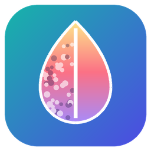
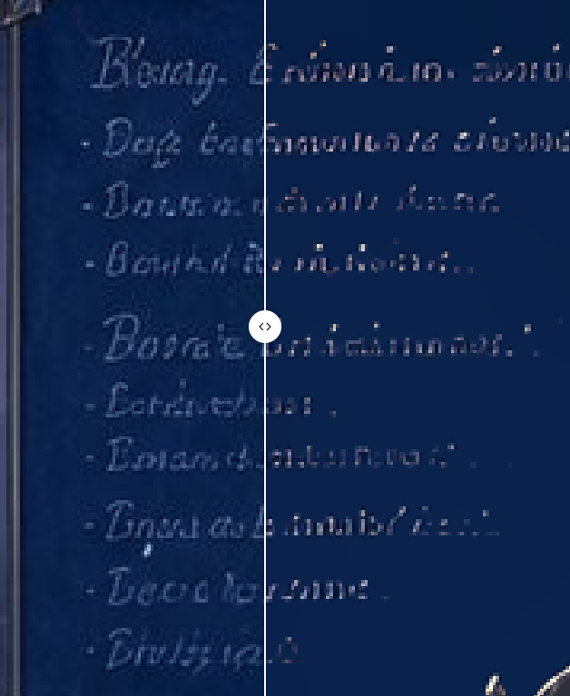
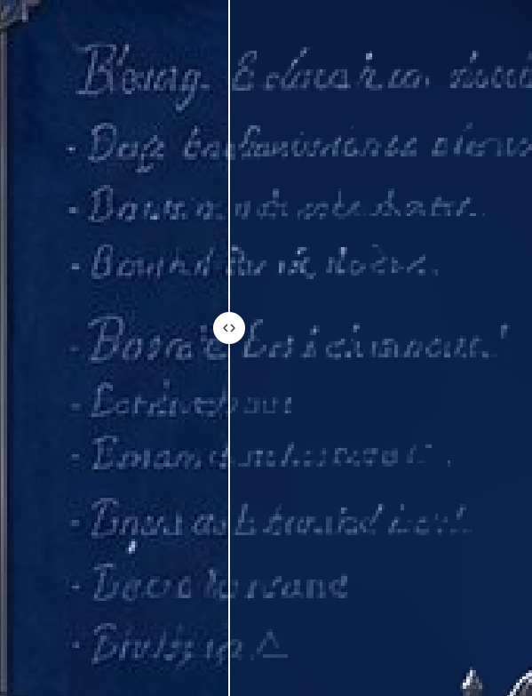
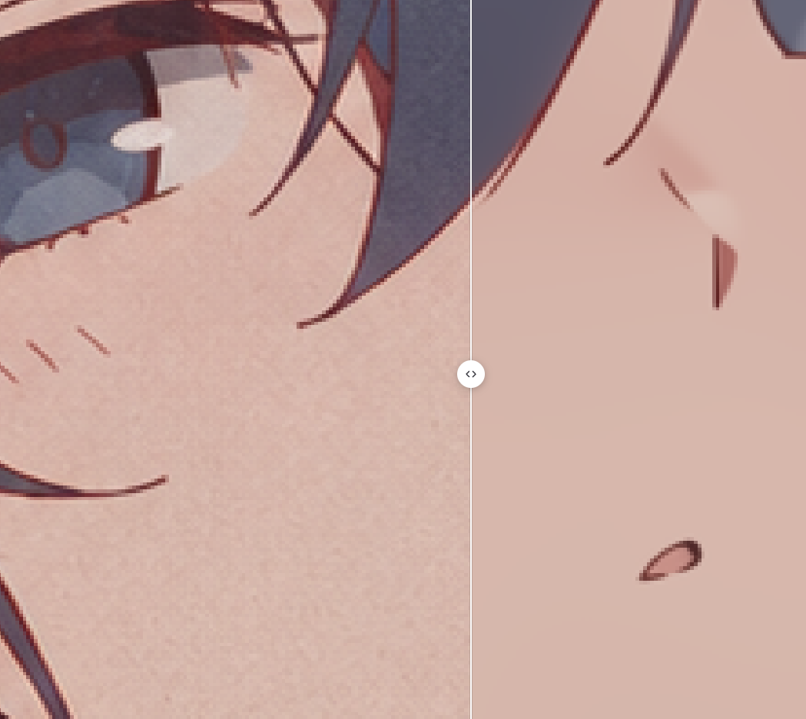

<p align="center"></p>

<h1 align="center">Denoise</h1>

<p align="center">在保持原图色彩的前提下，去掉压缩伪影、振铃、摩尔纹和鱼鳞纹。<br>
Remove compression artifacts, ringing, moiré and fish-scale texture while keeping the original colours.</p>

---

## 为什么不用超分模型

常见做法是「先缩小，再用 ESRGAN 一类的超分模型放大回来」。这类方法去噪靠的是**重绘**：输出的每个像素都是模型重新画出来的，于是：

- **色彩和原图不一致**：整体会被提亮、肤色偏粉偏艳，和原图放在一起能明显看出色差；
- **细节丢失**：淡淡的腮红、细小的纹理、笔触、小字会被抹平或者画成别的样子，线条也是重画的；
- **即使开很低的档位也不能避免**：只要图经过一遍重建，像素就是模型画的，档位只能改变「画多少」，改变不了「是重画」这件事。

Denoise 在**原尺寸**上去噪，不缩小、不重画：线条的位置、颜色、细节都留在原处，只把伪影去掉。

包含锐化（APISR）纯属作者个人喜好。

## 示例

左边 ESRGAN，右边 Denoise：

<p align="center"> </p>

去噪效果：左边原图上的细碎纹理被去掉，右边色块干净，颜色不变。

<p align="center"></p>

## 使用

1. 下载本仓库（**Code → Download ZIP** 后解压，或 `git clone`）。
2. 双击 **`Denoise.exe`**。
3. 第一次运行会弹窗确认，然后自动准备运行环境（有进度窗口，装完自动打开）：
   - **NVIDIA 显卡**：CUDA 版 PyTorch，自动选驱动能跑的最新版本（只需要显卡驱动，不用装 CUDA Toolkit）；
   - **AMD 显卡**：AMD 官方 ROCm 7.2.1 for Windows 版 PyTorch，支持 RX 7000 / 9000、Radeon PRO W7000 / W9000 / R9700、Ryzen AI Max；其他 AMD 显卡用 CPU；
   - **都没有**：CPU 版。
   - 下载量约 0.3 GB（CPU）到 3 GB（NVIDIA），全部装在本文件夹的 `runtime` 和 `models` 里，不改系统；**删掉文件夹就是卸载**。国内网络会自动换镜像。
4. 之后再双击就直接打开（浏览器里的本机页面，图片不会上传到任何地方）。

> Windows 第一次运行没签名的程序时可能提示「Windows 已保护你的电脑」，点「更多信息 → 仍要运行」即可。`Denoise.exe` 的源码在 `launcher/Denoise.cs`，可以用 `launcher\build.cmd` 自己编译。

### 页面

- **处理步骤**，依次执行：
  - **APISR 锐化**（默认关）：会改变原有色彩，页面上有提示；
  - **DRUNet 去噪**（默认开）：原尺寸去伪影、振铃、摩尔纹、鱼鳞纹，不改颜色；
  - **L0 平滑**（默认关）：把色块里残留的细碎起伏压平，很淡的渐变也会被抹平一些。
  - 点 **更多设置** 展开：APISR 档位（2× RRDB 默认 / 4× RRDB / 4× GRL / 4× DAT，用到才下载）、APISR 强度、DRUNet 强度、L0 强度。
- **默认只开 DRUNet，并对所有图片生效**。改了设置后点 **对该图生效**（只改当前这张）或 **对所有图生效**（全部，之后放进来的图也用它）才会应用。
- **保护笔刷**：不想被处理的地方涂上，就按比例换回原图，马上生效；可调大小、恢复比例、柔边，支持橡皮、撤销 / 重做。
- **对比**：左右分割线、原图 / 结果切换、按住 `Z` 看原图、滚轮缩放、拖动平移。
- **浅色 / 深色**：跟随系统，或在右上角切换。
- **输出**：结果自动保存为 `<原文件名>_clean.png`，默认在本文件夹的 `output`，右上角「输出」可以改成别的文件夹或恢复默认。透明背景和色彩配置会保留。

### 命令行

```bash
runtime\venv\Scripts\python denoise.py photo.png                 # 默认：只开 DRUNet，结果在 output\
runtime\venv\Scripts\python denoise.py a.png b.jpg --apisr --l0   # APISR → DRUNet → L0
runtime\venv\Scripts\python denoise.py folder --out clean --sigma 14
runtime\venv\Scripts\python denoise.py --help
```

## 原理

- **DRUNet 像素重排去噪**：伪影的相邻像素是相关的，隔一个像素就基本不相关。把图按 2×2 拆成 4 张隔点小图，伪影在小图里就变成了接近白噪声的东西，交给高斯去噪网络 DRUNet 干净地去掉，再拼回原图、轻扫一遍消除拼接痕迹。全程原尺寸，不缩放、不重画，颜色不变。
- **APISR**：动漫 / 插画修复网络，在原尺寸上分块运行、每块放大后立刻缩回，再按强度和原图混合。
- **L0 平滑**：L0 梯度最小化（Xu et al., *Image Smoothing via L0 Gradient Minimization*, SIGGRAPH Asia 2011），只保留值得保留的边缘，把色块内部压平。

## 许可

- 代码：MIT（见 `LICENSE`）。
- 模型不随仓库分发，第一次用到时从原作者的发布地址下载（失败时用 HuggingFace 上哈希一致的镜像），带 SHA-256 校验，使用时遵守各自的许可：[DRUNet / DPIR](https://github.com/cszn/DPIR)（MIT）、[APISR](https://github.com/Kiteretsu77/APISR)（GPL-3.0）。
